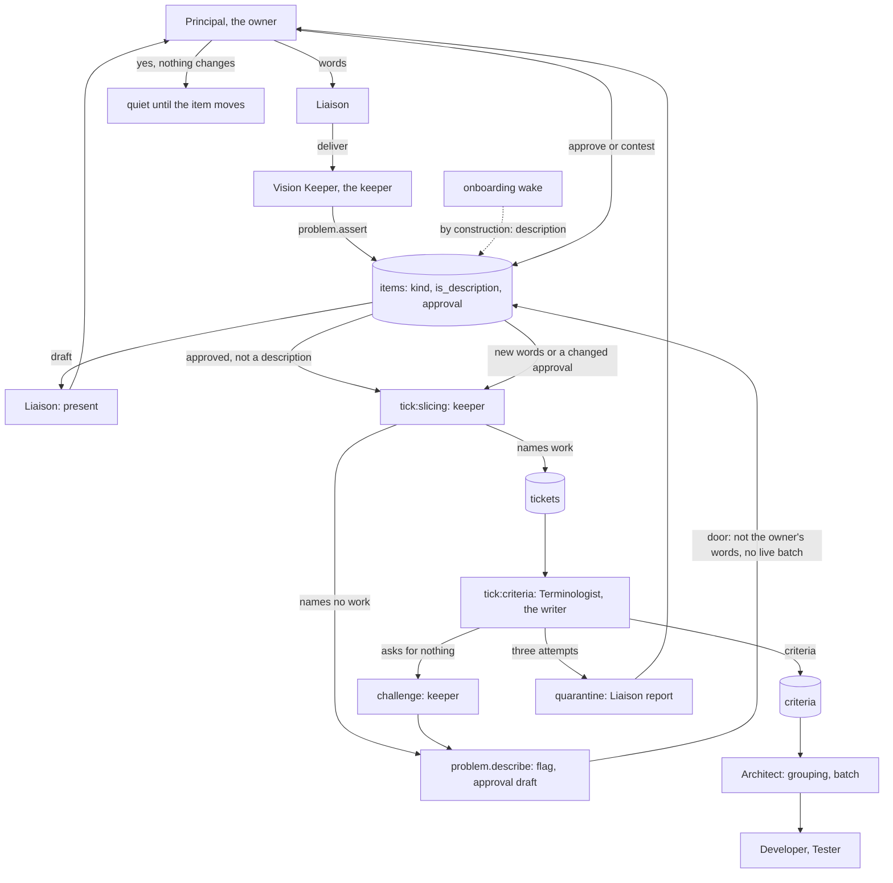

# Design record: a quarantined criteria tick wakes again for ever (frame 80)

Written by the assistant, session a664990b, on 2026-09-24 12:41, for a
design review before any code. Revision 2 at 12:44 folds the design
review's ten answers and nine findings (observed: the reviewer on Opus
5.5, 120.4k on the harness line, 49 tool calls, 6.5 minutes; its probes
are `p1.py` to `p5.py` in this session's scratchpad). Revision 3 at
13:15 adds the second half, a description owes no ticket, from Roman's
rulings at the grill, 12:50 to 13:12. Meta workflow for the build. Rota
workflow for the fault. Revision 4 at 13:24 folds the second review's ten findings (observed:
the reviewer on Opus 5.5, 109.3k on the harness line, 54 tool calls, 6.7
minutes; probes in `r2/` in this session's scratchpad). The tree is
`c4827b7`.

The frame has two halves. The first is the safety net: a give-up that
was reported once must not loop. The second is the golden path: a
description never enters the criteria queue. Roman ruled the second
half in on 2026-09-24 12:50: "it doesn't make sense for giving up to be
on the golden path" (ruled: Roman, at the grill, on the question what a
"yes" to a give-up report should do). The two halves share one night.

## The fault (observed: `.rota/clickI_night91.db`, 2026-09-24 12:30)

- The item `bg_1_summary` was written by the Vision Keeper in `s207`,
  woken by the Architect's `propose` `m92` in the thread of the
  Developer's `escalate` `m91` on `bg_1`. The seat called
  `problem.assert` twice, first with `id='bg_1'` and then with
  `id='bg_1_summary'`. Only the second landed: the `receipts` table holds
  `s207`, `items`, `bg_1_summary` and no `items` row `bg_1`. The text is
  a summary of Click with one sentence on `echo_json`. The principal
  approved it at `m103` to `m105` (`rulings` `r_a66b9db45a`). The slicing
  tick `s228` wrote its one ticket, `tk_1_bg_1_summary`: "the software is
  a command-line interface toolkit called Click".
- `tick_criteria` (`rota/core/scheduler.py:286-299`) wakes the
  Terminologist per item whose ticket has no criteria. The key is
  `terminologist|tick:criteria|bg_1_summary`. Each session sends one
  `challenge` to the Vision Keeper and writes no criterion (`m121`,
  `m122`, `m123`; the third says `criteria.specify` refused
  `surface_refs=[echo_json]`; the first two name `tk_1` and `echo_json`,
  not the summary ticket). At `tick_attempt_cap` 3, `quarantine_stalled`
  (`scheduler.py:1489`) sets `quarantined` 1.
- `quarantined` (`rota/core/predicates.py:1316`) wakes the Liaison with
  the detail `1 abandoned: criteria for bg_1_summary (terminologist), 3
  attempts`. `rota/core/loop.py:330` then sets `reported` 1 on every
  quarantined key. The Liaison presents the item (`m124`), the principal
  converses and gives a verdict (`m125`, `m126`), the Liaison's converse
  and verdict sessions write a `rulings` row (`r_7d997870c7`,
  `bg_1_summary: approve`) and relay to the Vision Keeper (`m127`).
- The relay session `s258` calls `problem.set_approval`,
  `problem.prioritize` and `problem.set_approval` again. Each is a write
  to `items` row `bg_1_summary` with `amends` False
  (`rota/roles/api.py:908-932`). The row's own `version` stays 1. The
  receipt's `new_version` 27 is the table counter
  (`rota/core/db.py:322-331`), not the row's.
- `session_commit` (`db.py:566-595`) calls `_lift_quarantines` for every
  write that is not a refs write. Its first statement (`db.py:500-503`)
  deletes every quarantined key whose refs name the written row id,
  `%|bg_1_summary`. The criteria key is gone, and the next pass produces
  the wake at attempts 1. The cycle ran five rounds of ten sessions,
  `s229` to `s278`: three `tick:criteria` sessions, three challenge
  answers, the Liaison's report, converse and verdict sessions, and the
  relay (observed: the review's probe `p2.py`; the frame's status of
  11:02 counted three rounds of nine from `s251`). The counter read
  attempts 1 at the stop.
- The same rule revived the exhausted key at every head commit on night
  91 (observed: frame 79's record, the route B section).

## Why the tick wakes again (reasoned: from the rows and the code above)

The rule's docstring says what it means: "A quarantine holds while its
subject is unchanged; a write that changes the subject is the exit." The
code keys on any write to the row, and never asks whether the subject
changed. The tree already distinguishes the two. `Write.amends`
(`db.py:245-252`) says that approval, priority and status transitions are
state changes and not content changes, and `_apply_write` moves the
row's `version` on an amendment only (`db.py:430-433`).

So the two halves of the design compose into a cycle. The quarantine
reports itself once. The report ends in a verdict. The verdict's relay
writes the subject's row with values that change nothing. The write
revives the tick. Nothing in the loop changes the subject, and the
composition says a question changes nothing: only a ratified amendment
to something approved revokes work downstream.

The obligation was real only because the ticket existed. The ticket
restates a description, and no criterion can be written for it. The
abandonment was said out loud once, which is what `quarantined` exists
for. Re-deriving the same debt after a verdict that changed nothing is
the first fault. That the ticket was cut at all is the second.

No ruled sentence promises the revive or describes the exit (observed:
the review's read of `rota/LAWS.md`). Law 6 says "The attempt caps and
the ladder bound a cycle." Night 91 breaks that sentence, and the first
half restores it. Neither half changes a law.

## The first half: a revive keys on a move of the subject, not on any write

`session_commit` reads the row's `version` and `approval` before
`_apply_write`, computes `moved` after it, and passes it to
`_lift_quarantines(conn, w, moved)`. `moved` is a required parameter,
so no caller can forget it. A write moves its subject when one of these
holds:

1. The row did not exist before the write. A new row is a new version.
2. The table has a `version` column, and the version after the write
   differs from the version before. That is an amendment, or a write
   that carries `version` in its values. Every artefact table with an
   `id` column has one (observed: the review's schema probe).
3. The table has an `approval` column, and the approval after the write
   differs from the approval before. The principal's ruling on the row
   moved. `reopen` (`predicates.py:855-863`) keys a Developer tick on
   the batch and the item and reads the item's approval, so a withdrawal
   or a re-approval revives that key (the review's finding 8). An
   approval written over the same approval, night 91's case, moves
   nothing.
4. The table is `batches` and `head_commit` is in the values. A new head
   commit is progress, the docstring's own case (`db.py:504-508`). The
   pipeline writes an existing `batches` row through `code.commit`
   alone (`api.py:9038`); `batches.group` refuses an existing id, and the
   status writers in `lifecycle.py` and `boot.py` write raw SQL outside
   `session_commit` (observed: the review's point 3). So rule 4 keeps
   every `batches` revive that exists today.
5. A junction write is a move. Its `row_id` is a label such as
   `bg_1:tk_1`, which no tick key holds, so the branch is inert today
   and stays inert (observed: the review's point 4). `code_index` and
   `claims` are not in `ARTEFACT_TABLES`, so `_lift_quarantines` never
   runs for them.

In `_lift_quarantines`, the first `DELETE` (`db.py:500-503`) and the
criteria-and-tests branch (`db.py:521-535`) run only when `moved` holds.
The `tests_failing` reset on a head commit (`db.py:512-514`) and the
`test_runs` reset on a body write (`db.py:509-511`) stay unconditional.
Their pins in `tests/rota/test_desk_guards.py:479-513` call
`_lift_quarantines(db, W)` with two arguments and gain `moved=True`.

One pattern changes in the first `DELETE`. `%,{row_id}%` has no end
anchor, so a write to `c_1` revives a key whose refs hold `,c_10`. It
becomes `%,{row_id}` and `%,{row_id},%`, as the `|` patterns already
are (the review's finding 7, PLAUSIBLE by reading; no night 91 key shows
it).

One flag changes beside it. `criteria.respecify`
(`rota/roles/api.py:3560-3621`) rewrites a criterion's text and surface
refs with `amends` False, so under rule 2 a repaired criterion would move
nothing, and the Tester that gave up on it would never wake. That is the
case the rule was written for (`tests/rota/test_steering.py:108-135`).
The flag was set False by `fd788bd` on 2026-08-26 with no reason in the
commit, and no reader in `rota/` reads a criterion's row `version`
(observed: the review's point 5). The route sets `amends` True on the
respecify write, so the repair moves the version. Of the seven pipeline
writes with `amends` False, it is the only content change; the others
are approval, priority, a statement's status, a ledger's status, a
message, and the head commit (observed: the review's point 2).

What the half buys, on night 91's own rows: the three writes of `s258`
move nothing, the key stays quarantined 1 and reported 1, `tick_criteria`
still produces the wake and `quarantine_stalled` still drops it, and the
frontier is quiet on the item (observed: the review's probe `p5.py`
replayed `s258` through `session_commit` with the route patched in, and
the key survived at 3, 1, 1). An amendment of the item, `problem.assert`
with new text, moves the version to 2 and revives the key.
`tick_slicing` already treats a new version as new debt under its own
key (`scheduler.py:270-284`), so the two rules agree.

The give-up rule, in Roman's words at the grill: a yes that changes
nothing changes nothing. The give-up stands, reported once. The writer
is asked again only when the item's words change or the owner's
approval changes (the assistant's reading of Roman's 12:50 answer, not
contradicted when the second half was ruled; a verdict that approves
what is approved is the report's end, because the tool never closes an
assumption for the principal, the composition, Flows).

## The second half: a description owes no ticket (ruled: Roman, 2026-09-24 12:50 to 13:12)

Roman's rulings at the grill, in order:

1. 12:50: giving up is not on the golden path. The ticket that asks for
   nothing is the cause, and the rule that keeps a description off the
   path folds into this frame.
2. 13:05: a description flag on the item, separate from in scope and out
   of scope, applied upstream where the item is born, and updatable at
   the criteria stage.
3. 13:10: the keeper's judgement happens during splitting, not as a
   separate call per item elsewhere.
4. 13:12: the describe call lives at splitting and on the writer's
   challenge, and the record carries a flow chart of the roles and
   processes.

**Words cannot tell a description from a request** (observed: night 91's
rows, 2026-09-24 13:00). Each item's prose words against the words of
every other item:

| item | words | already said | new | said |
| --- | --- | --- | --- | --- |
| `how_it_works`, the account | 28 | 18 | 10 | 0.64 |
| `defines_commands_and_options` | 15 | 15 | 0 | 1.00 |
| `parses_and_executes_inputs` | 12 | 9 | 3 | 0.75 |
| `provides_command_line_interface` | 12 | 10 | 2 | 0.83 |
| `echo_json`, the one request | 9 | 7 | 2 | 0.78 |
| `bg_1_summary`, the description | 36 | 25 | 11 | 0.69 |

`_near_duplicate(summary, account)` is False, 13 shared words of 36.
The summary and the one real request score the same, and the onboarding
items score worse. So no door on words. The detector is the seat that
reads the item to cut it, and the seat that reads the ticket to write
its criteria.

**Where the flag is set, upstream by construction.** Every item is born
through `problem.assert`, in nine of the keeper's modes (observed: the
`.tools` files, 13:03). The tool knows the wake it runs under:
`ctx.onboarding` holds when the wake is in `ONBOARDING_TICKS`
(`rota/core/runner.py:1974`), and `stage_grain_refs` already keys the
observed provenance on it (`api.py:596-604`). `problem.assert` writes
`is_description` 1 when `ctx.onboarding` holds or the id is
`how_it_works`, and 0 otherwise. The two implicit rules in
`tick_slicing`, the account by id and the observed provenance
(`scheduler.py:250-256`), stay as they are; the flag is a third skip
beside them, and it is the one the keeper can set.

**Where the keeper sets it, at splitting.** A new op,
`problem.describe(id)`, beside `problem_set_approval` (`api.py:908`).
It writes one row with `amends` False: `is_description` 1 and `approval`
`draft`, the version unchanged. `amends` True was the first draft, and
the review showed it wrong twice: a version move never reaches the
owner, because `tick_signoff` lists `draft` rows only, and it fires
`cancel` and `reopen` on any live batch of the item (CONFIRMED, the
review's finding 1, probe `q10.py`; the case `L1-VK-slice` forbids a
version move in slicing for the same reason). `draft` is what brings an
item to the present, so the owner sees the word there and approves or
contests it. Under the first half's rule 3 the approval change is a
move, so a quarantined key on the item is revived once, never produced
again, and forgotten.

The op has a door (the review's finding 5). Night 91's three challenges
named `tk_1` and `echo_json`, the one real request, and none said "asks
for nothing". A describe with no door can take the real request off the
path. So `problem.describe` refuses an item whose provenance is
`decided`, the principal's own words, and an item with a batch that is
not merged or abandoned. `bg_1_summary` is `reasoned` and has no batch,
so the door lets the summary through. A refusal names the way back: a
challenge answer by `decisions.author`.

The op needs an edge in `rota/design/graph.json`, `vision_keeper writes
problem "describe"`, because the sandbox builds a mode's functions from
the graph and a `.tools` line only narrows them (`sandbox.py:474-480`,
the review's finding 8). The docstring's first paragraph is the tool's
advertised text (`toolschema.py:18-23`), so it is brief text. Offered in
`vision_keeper/slicing.tools` and `vision_keeper/challenge.tools`.
`slicing.md` gains one paragraph: an item that names no piece of work is
a description; send one `problem.describe` for it and no ticket, with an
example in the brief's own shape. `challenge.md` gains a third answer:
when the challenge says the item's tickets ask for nothing,
`problem.describe` the item; no reopen, because nothing was built on it.
The Terminologist's criteria brief does not change; if night 92 shows
the writer not saying "asks for nothing", one line there is the next
frame's.

By construction, `problem.assert` stages `is_description` 1 only when it
is 1, on an onboarding wake or for `how_it_works`, and stages no key
otherwise. A later assert off an onboarding wake, a contested
amendment of a described item, then leaves the flag as it is (the
review's finding 6).

**Who reads the flag.** Three producers skip a description:
`tick_slicing` (`scheduler.py:250-284`), `tick_criteria` (`:286-299`),
and `grouping` (`predicates.py:524-529`), which keys on tickets that
have criteria and would group a described item's ticket (CONFIRMED, the
review's finding 2). `criterion_repair` needs criteria and a Tester
question first, so it needs none. `batch_start` and `preempt` gate on
the approval already. The skip guards on `_has_column`, because
`frontier_readonly`, the trace view and the CLI open an old run
database read-only and never run `init_db` (the review's finding 7).

`problem.consult` and the page's row resolver (`runner.py:1302`) keep
their selects as they are, and emit `is_description` only when it is 1.
Both selects appear in the user text of recordings, 498 and 311 of
3975, and the recording key hashes that text, so a new key on every row
would stale them across many roles (CONFIRMED, the review's finding 3).
The owner's page (`principal.py:315-327`) gives descriptions their own
heading, because the summary says Click "includes a helper function
echo_json", which was the running request and not what the repository
does today (the review's finding 4).

**Schema.** `items.is_description INTEGER NOT NULL DEFAULT 0` in
`rota/core/schema.sql:50`, and the `init_db` column pattern
(`db.py:221-224`) for a run database that predates it.

**Re-records.** Twenty-one keeper cases exist in `tests/rota/cases`
(observed: the review's probes `q2.py` and `q3.py`; the record's nine
was a count of files). Three run the two modes and re-record:
`L1-VK-slice`, `L1-VK-decide-a-challenge-to-an-approved-item` and
`L3-scope-becomes-a-ticket-with-criteria`. One new case records the
slicing session on a description item.

### The flow, roles and processes (ruled: Roman asked for it, 13:12)

The golden path is the top and the middle: words, item, present, cut,
criteria, batch. A description leaves it at the cut, or at the writer's
challenge, and returns to the owner's page as a draft under its own
heading. The describe door keeps the owner's own words and any item
with a live batch on the path. The give-up path at the bottom is the
safety net, and after the first half it ends where the owner's yes
lands. The onboarding edge changes no skip: the account and the observed
rows are skipped already, and the flag names them.

## The pinned tests

In `tests/rota/test_steering.py`, beside
`test_a_quarantine_lifts_when_its_subject_moves`:

1. `test_a_verdict_that_changes_nothing_revives_nothing`, the cycle once:
   seed the item `bg_1_summary` approved at version 1, its ticket with no
   criteria, and the key `terminologist|tick:criteria|bg_1_summary` at
   attempts 3, quarantined 1, reported 1. Commit one Vision Keeper
   session through `session_commit` with the three writes of `s258`,
   `amends` False. The key survives with its counts, and `frontier`
   inside a rolled-back transaction holds no `tick:criteria` wake with
   refs `bg_1_summary`. `frontier_readonly` never calls
   `quarantine_stalled`, so it lists the wake and is the wrong reader
   (the review's finding 1). The steering fixture's `t1` has no criteria
   either, so the assertion filters by refs. Then commit an amendment of
   the item's text, `amends` True. The key is gone, and the wake is back.
2. The existing pin, `test_a_quarantine_lifts_when_its_subject_moves`,
   calls `_lift_quarantines(db, W)` with a bare class. It becomes a
   commit of a respecify-shaped write, `criteria` `c1` with new text
   through `session_commit`, and its two assertions stay.
3. `test_a_head_commit_still_revives_the_batchs_keys`: a quarantined
   `critic|tick:review|b1` and a `batches` write carrying `head_commit`
   with `amends` False. The key is gone.
4. `test_an_approval_change_moves_the_item`: a quarantined
   `developer|tick:reopen|b1,i1`. A `set_approval` write of `approved`
   over `approved` leaves it. A write of `contested` removes it.
5. `test_a_respecified_criterion_moves_its_version`, beside the op's
   other pins: the op's write reaches `session_commit` with `amends`
   True and the row's version moves.
6. One assertion for the anchor: a write to `c_1` leaves a quarantined
   key whose refs end in `,c_10`, and removes one whose refs hold `,c_1`.

For the second half, in `tests/rota/test_predicates.py` beside the
slicing and criteria pins, and in `tests/rota/test_desk_guards.py` for
the doors:

7. `tick_slicing` produces no wake for an approved in-scope item with
   `is_description` 1 and no tickets.
8. `tick_criteria` produces no wake for a ticket with no criteria whose
   item has `is_description` 1, and produces it again at 0. Night 91's
   shape: `bg_1_summary` and `tk_1_bg_1_summary`.
9. `problem.describe` writes `is_description` 1 and `approval` `draft`
   with `amends` False: the version stays, `tick_signoff` lists the
   item, and no `cancel` or `reopen` wake appears. The pin calls the op
   through the sandbox, which covers the graph edge.
10. The describe door: an item with `decided` provenance is refused; an
    item with a running batch is refused; a `reasoned` item with no
    batch is described.
11. `problem.assert` on an onboarding wake writes `is_description` 1; on
    a deliver wake it stages no key; `how_it_works` gets 1 on any wake.
    The texts pass the account door (`api.py:806`) and differ from the
    stored words (`:880`).
12. `grouping` produces no wake for a described item's ticket with
    criteria.
13. The owner's page, through `runner._resolve_refs`, lists a
    description under its own heading, and never under "It would".
14. `frontier_readonly` on a database without the column raises
    nothing.

The pins seed rows by SQL and commit through `session_commit` with
`SessionResult` and `Write`, as `tests/rota/test_refs.py` does. A
session row needs `id`, `role` and `seq`; `session_commit` writes them.

## The walk

One warm night, `GAUNTLET_NIGHT=92`, from a worktree at this frame's
closing commit, by the shape of `.rota/launch_night91.sh`, with
`ROTA_REPO` at `C:/Users/roman/rota_night92` and `ROTA_RUNS` at the main
checkout's `.rota`. Frames 81, 79 and 80 close on that night, each on
the line its record's walk section names. This frame's two lines:

- First half: after a Liaison `tick:quarantined` session on any key, no
  `tick:criteria` session runs on that key while its item's version and
  approval stay, so the Terminologist's sessions on one key number at
  most three in the night.
- Second half: no `tick:criteria` session runs on an item with
  `is_description` 1, and a description written by a seat reaches the
  owner's page under what the repository does today, with one
  `problem.describe` call in the keeper's slicing or challenge session
  behind it.

The night's third observation, not a gate: what the run does once the
summary is off the path, because night 91 never got there. On night 91's
rows with the first half in place, the frontier's next wakes are the
Architect on `tick:exhausted` for `bg_1` (frame 79's field), the Tester
on `tick:tests_missing` for `bg_1`, and two Critic `tick:challenge`
wakes, one on `@claim:items:bg_1_summary` (observed: the review's
point 9).

## Out of scope, recorded for the next frame that meets them

- The `tick:criteria` key names the item, and the debt belongs to the
  ticket. An amendment of `tk_1_bg_1_summary` matches no pattern, so it
  revives nothing today and nothing under the route (the review's
  finding 9). One line in `tick_criteria` or in the revive, for the
  frame that next touches the criteria tick.
- The Liaison's `quarantined` brief (`rota/roles/prompts/liaison/
  quarantined.md`) describes the message case only: "a message failed too
  many times", "infrastructure failing, not anybody's judgement". A tick
  quarantined on a seat's refusal to write is a judgement. A brief change
  re-records the Liaison's quarantined cases, so it waits for a frame on
  that brief.
- A quarantined key whose wake is no longer produced stays in
  `tick_attempts` for ever. `quarantine_stalled` forgets a key only while
  `quarantined` is 0. Cosmetic, and the count stays honest.
- The Terminologist's criteria brief may need "or asks for nothing"
  beside "cannot mean anything consistent". Night 92 decides.
- Frame 79's notes carry over: three predicates match a batch id without
  quotes; the Architect's exhausted brief opens with a sentence route B
  makes imprecise; a tick as a message cause. The review saw the
  Architect's `tick:exhausted` wake read "attempt 12 of 10" with no
  Architect exhausted session on file, on night 91's rows; that is frame
  79's field and its night.
- The gate's stored baseline is `b82565d` of 2026-09-21. Roman's call.

## Price (reasoned: frame 79's actuals, in its status of 12:24)

First half. Design review: 120.4k on Opus, actual, against 95k
estimated. Build 60k to 80k on Opus: two functions in `db.py`, one flag
in `api.py`, six pins (frame 79: 86.6k over three passes, on a larger
surface).

Second half. Design review: 109.3k on Opus, actual, against 80k
estimated. Build 80k to 100k on Opus: one column and its migration, one
op with a door and a graph edge, two tools files, two briefs, three
predicate skips with a column guard, one page heading, two selects that
emit one key, eight pins, and the re-record of three keeper cases with
one new case, about twenty minutes of GPU.

Both halves. One diff review about 120k on Fable; the write pipeline
and two predicates are touched, so the review probes every branch of
`_lift_quarantines` and both skips. Gate 15k here, one run. The night:
about three hours of GPU (night 91 ran 3 hours 16 minutes to the stop)
and about 30k of this context to read it and close three frames, an
estimate with no anchor in the register. About 400k in agents after the
first review, walls apart.
