# Frame 314 probe report: a flow chart drawn from the wiring and the tick predicates

Verdict: the tool works and its output is deterministic. The chart is partly useful. A reader can follow the back half of a change, from a running batch to the merge. A reader cannot follow the front half, from the request to the batch, because the triggers of that half are not in the two sources.

## The shape of the sources

- `rota/design/graph.json` has four keys: `nodes`, `edges`, `contact_exceptions`, `silent_channels`.
- A node with `type` "role" or "principal" names a seat. Eight roles exist, and the principal makes nine seats. A node with `type` "artefact" names a record kind (21 artefacts).
- An edge is an object with `s` (source), `t` (target) and `type`. The types are `writes` (60), `messages` (56), `reads` (97) and `refs` (25).
- No key names a tool. The nearest thing is the verb `v` on a `writes` or `messages` edge, for example `commit`, `emit`, `slice`. The probe treats the verb as the tool name.
- `contact_exceptions` is empty. `silent_channels` lists four seat pairs that never message each other.
- `rota/core/predicates.py` registers 48 predicates with the `@predicate` decorator. Each one declares `wakes` (a role id, `DERIVED` "*" or `SCHEDULER` "-"), `band` (traffic, fix, gate, start), `drains` (table, column, value) and sometimes `derives`.
- The scheduler calls `all_wakes`. It sorts the predicates by band, then by file position, calls each function on the database, and joins the wakes. `frontier` runs four quarantine and resume writes first, then filters the wakes. The probe read only that part of the scheduler.

## (a) The chart

The file is `D:/repos/rota/probes/flowchart/flowchart.mmd`. It is pasted whole below. The probe did not render it, because no Mermaid renderer was run.

```mermaid
flowchart LR
  %% generated by probes/flowchart/flowchart.py; do not edit
  subgraph lane_any_seat["any_seat"]
    t_message_tips_any_seat(["traffic: message_tips"])
    t_checkpoint_invalid_any_seat(["fix: checkpoint_invalid"])
    t_survey_any_seat(["start: survey (trigger in scheduler, not read)"])
  end
  subgraph lane_architect["Architect"]
    t_guess_architect(["gate: guess"])
    t_grouping_architect(["start: grouping"])
    t_annotate_architect(["start: annotate"])
    t_exhausted_architect(["fix: exhausted"])
    t_findings_exhausted_architect(["fix: findings_exhausted"])
    t_unresolved_architect(["fix: unresolved"])
    t_structural_review_architect(["gate: structural_review"])
    t_frame_architect(["start: frame (trigger in scheduler, not read)"])
    t_boundary_architect(["start: boundary (trigger in scheduler, not read)"])
    t_touch_strayed_architect(["fix: touch_strayed"])
  end
  subgraph lane_critic["Critic"]
    t_review_critic(["gate: review"])
    t_finding_review_critic(["gate: finding_review"])
    t_challenge_critic(["start: challenge (trigger in scheduler, not read)"])
  end
  subgraph lane_developer["Developer"]
    t_batch_start_developer(["start: batch_start"])
    t_tests_failing_developer(["fix: tests_failing"])
    t_reopen_developer(["fix: reopen"])
    t_exhausted_developer(["fix: exhausted"])
    t_findings_exhausted_developer(["fix: findings_exhausted"])
    t_verdict_failed_developer(["fix: verdict_failed"])
    t_finding_violated_developer(["fix: finding_violated"])
    t_touch_mistaken_developer(["fix: touch_mistaken"])
  end
  subgraph lane_liaison["Liaison"]
    t_request_shift_liaison(["traffic: request_shift"])
    t_awaiting_confirm_liaison(["gate: awaiting_confirm"])
    t_contradiction_liaison(["fix: contradiction"])
    t_round_close_liaison(["gate: round_close (trigger in scheduler, not read)"])
    t_observed_entries_liaison(["start: observed_entries"])
    t_touch_note_liaison(["start: touch_note"])
    t_unresolved_liaison(["fix: unresolved"])
    t_quarantined_liaison(["fix: quarantined"])
    t_park_ask_liaison(["fix: park_ask"])
    t_agenda_liaison(["start: agenda (principal present)"])
    t_blindspot_liaison(["start: blindspot (trigger in scheduler, not read)"])
  end
  subgraph lane_principal["Principal"]
    idle_principal["no tick wakes this seat"]
  end
  subgraph lane_researcher["Researcher"]
    idle_researcher["no tick wakes this seat"]
  end
  subgraph lane_scheduler["scheduler"]
    t_harness_scheduler(["gate: harness"])
    t_cancel_scheduler(["fix: cancel"])
    t_preempt_scheduler(["fix: preempt"])
    t_merge_scheduler(["gate: merge"])
    t_constraint_zero_scheduler(["gate: constraint_zero"])
  end
  subgraph lane_terminologist["Terminologist"]
    t_term_collision_terminologist(["fix: term_collision"])
    t_criteria_terminologist(["start: criteria (trigger in scheduler, not read)"])
    t_criterion_repair_terminologist(["fix: criterion_repair"])
    t_define_terminologist(["start: define (trigger in scheduler, not read)"])
  end
  subgraph lane_tester["Tester"]
    t_tests_missing_tester(["start: tests_missing"])
  end
  subgraph lane_vision_keeper["Vision Keeper"]
    t_contested_vision_keeper(["fix: contested"])
    t_signoff_vision_keeper(["gate: signoff"])
    t_slicing_vision_keeper(["start: slicing (trigger in scheduler, not read)"])
    t_exhausted_vision_keeper(["fix: exhausted"])
    t_findings_exhausted_vision_keeper(["fix: findings_exhausted"])
    t_unresolved_vision_keeper(["fix: unresolved"])
    t_orient_vision_keeper(["start: orient (trigger in scheduler, not read)"])
    t_reconcile_vision_keeper(["start: reconcile (trigger in scheduler, not read)"])
    t_reorient_vision_keeper(["start: reorient (trigger in scheduler, not read)"])
  end
  subgraph records["records"]
    subgraph tbl_area_provenance["area_provenance"]
      s_area_provenance_basis_code["basis = code"]
    end
    subgraph tbl_batch_touch["batch_touch"]
      s_batch_touch____["batch_touch (any row)"]
      s_batch_touch_confidence_expected["confidence = expected"]
    end
    subgraph tbl_batches["batches"]
      s_batches____["batches (any row)"]
      s_batches_status_abandoned["status = abandoned (end)"]
      s_batches_status_deferred["status = deferred"]
      s_batches_status_merged["status = merged (end)"]
      s_batches_status_pending["status = pending"]
      s_batches_status_running["status = running (end)"]
    end
    subgraph tbl_challenge["challenge"]
      s_challenge____["challenge (any row)"]
    end
    subgraph tbl_checkpoints["checkpoints"]
      s_checkpoints____["checkpoints (any row)"]
    end
    subgraph tbl_constraint_provenance["constraint_provenance"]
      s_constraint_provenance_basis_code["basis = code"]
    end
    subgraph tbl_constraints["constraints"]
      s_constraints____["constraints (any row)"]
    end
    subgraph tbl_criteria["criteria"]
      s_criteria____["criteria (any row)"]
    end
    subgraph tbl_decisions["decisions"]
      s_decisions____["decisions (any row)"]
    end
    subgraph tbl_finding_rulings["finding_rulings"]
      s_finding_rulings_ruling_upheld["ruling = upheld"]
    end
    subgraph tbl_findings["findings"]
      s_findings_status_violated["status = violated"]
    end
    subgraph tbl_frame["frame"]
      s_frame____["frame (any row)"]
    end
    subgraph tbl_glossary_terms["glossary_terms"]
      s_glossary_terms____["glossary_terms (any row)"]
    end
    subgraph tbl_item_provenance["item_provenance"]
      s_item_provenance_basis_code["basis = code"]
    end
    subgraph tbl_items["items"]
      s_items_approval_approved["approval = approved (end)"]
      s_items_approval_contested["approval = contested"]
      s_items_approval_draft["approval = draft"]
      s_items_approval_pending["approval = pending (end)"]
    end
    subgraph tbl_ledger["ledger"]
      s_ledger____["ledger (any row)"]
      s_ledger_status_open["status = open"]
      s_ledger_status_resolved["status = resolved (end)"]
    end
    subgraph tbl_messages["messages"]
      s_messages____["messages (any row)"]
      s_messages_from_role_principal["from_role = principal"]
      s_messages_from_role_tester["from_role = tester"]
      s_messages_status_answered["status = answered (end)"]
      s_messages_status_open["status = open"]
      s_messages_status_quarantined["status = quarantined"]
      s_messages_status_unresolved["status = unresolved"]
      s_messages_verb_converse["verb = converse"]
      s_messages_verb_question["verb = question"]
    end
    subgraph tbl_references["references"]
      s_references____["references (any row)"]
    end
    subgraph tbl_rulings["rulings"]
      s_rulings____["rulings (any row)"]
    end
    subgraph tbl_schedule["schedule"]
      s_schedule____["schedule (any row)"]
    end
    subgraph tbl_statements["statements"]
      s_statements_status_clarified["status = clarified (end)"]
      s_statements_status_contradicted["status = contradicted"]
      s_statements_status_proposed["status = proposed"]
      s_statements_status_ratified["status = ratified (end)"]
      s_statements_status_superseded["status = superseded (end)"]
    end
    subgraph tbl_survey_records["survey_records"]
      s_survey_records_outcome_found["outcome = found (end)"]
      s_survey_records_outcome_none_found["outcome = none_found (end)"]
    end
    subgraph tbl_term_provenance["term_provenance"]
      s_term_provenance_basis_code["basis = code"]
    end
    subgraph tbl_test_runs["test_runs"]
      s_test_runs_result_error["result = error"]
      s_test_runs_result_fail["result = fail"]
      s_test_runs_result_pass["result = pass (end)"]
    end
    subgraph tbl_tests["tests"]
      s_tests____["tests (any row)"]
    end
    subgraph tbl_tickets["tickets"]
      s_tickets____["tickets (any row)"]
    end
    subgraph tbl_touch_strays["touch_strays"]
      s_touch_strays_status_mistake["status = mistake"]
      s_touch_strays_status_open["status = open"]
    end
    subgraph tbl_transcript["transcript"]
      s_transcript____["transcript (any row)"]
    end
    subgraph tbl_verdicts["verdicts"]
      s_verdicts_result_fail["result = fail"]
      s_verdicts_result_pass["result = pass (end)"]
    end
  end
  s_area_provenance_basis_code -->|drains| t_observed_entries_liaison
  s_batch_touch____ -->|table| t_annotate_architect
  s_batch_touch_confidence_expected -->|sql| t_touch_note_liaison
  s_batches____ -->|table| t_annotate_architect
  s_batches_status_deferred -->|drains| t_batch_start_developer
  s_batches_status_deferred -->|drains| t_cancel_scheduler
  s_batches_status_deferred -->|sql| t_guess_architect
  s_batches_status_deferred -->|sql| t_park_ask_liaison
  s_batches_status_deferred -->|drains| t_reopen_developer
  s_batches_status_deferred -->|sql| t_touch_note_liaison
  s_batches_status_pending -->|drains| t_batch_start_developer
  s_batches_status_pending -->|drains| t_cancel_scheduler
  s_batches_status_pending -->|sql| t_guess_architect
  s_batches_status_pending -->|sql| t_touch_note_liaison
  s_batches_status_running -->|drains| t_cancel_scheduler
  s_batches_status_running -->|sql| t_finding_review_critic
  s_batches_status_running -->|sql| t_findings_exhausted_architect
  s_batches_status_running -->|sql| t_findings_exhausted_developer
  s_batches_status_running -->|sql| t_findings_exhausted_vision_keeper
  s_batches_status_running -->|sql| t_guess_architect
  s_batches_status_running -->|drains| t_preempt_scheduler
  s_batches_status_running -->|drains| t_reopen_developer
  s_batches_status_running -->|sql| t_review_critic
  s_batches_status_running -->|sql| t_structural_review_architect
  s_batches_status_running -->|sql| t_tests_missing_tester
  s_batches_status_running -->|sql| t_touch_note_liaison
  s_checkpoints____ -->|table| t_checkpoint_invalid_any_seat
  s_constraint_provenance_basis_code -->|drains| t_observed_entries_liaison
  s_decisions____ -->|table| t_term_collision_terminologist
  s_finding_rulings_ruling_upheld -->|sql| t_findings_exhausted_architect
  s_finding_rulings_ruling_upheld -->|sql| t_findings_exhausted_developer
  s_finding_rulings_ruling_upheld -->|sql| t_findings_exhausted_vision_keeper
  s_findings_status_violated -->|drains| t_finding_violated_developer
  s_glossary_terms____ -->|table| t_term_collision_terminologist
  s_item_provenance_basis_code -->|drains| t_observed_entries_liaison
  s_items_approval_approved -->|sql| t_grouping_architect
  s_items_approval_approved -->|sql| t_guess_architect
  s_items_approval_contested -->|drains| t_contested_vision_keeper
  s_items_approval_draft -->|sql| t_guess_architect
  s_items_approval_draft -->|drains| t_signoff_vision_keeper
  s_ledger____ -->|table| t_term_collision_terminologist
  s_ledger_status_open -->|drains| t_agenda_liaison
  s_messages____ -->|table| t_term_collision_terminologist
  s_messages_from_role_principal -->|sql| t_request_shift_liaison
  s_messages_from_role_tester -->|sql| t_tests_missing_tester
  s_messages_status_open -->|drains| t_message_tips_any_seat
  s_messages_status_open -->|sql| t_tests_missing_tester
  s_messages_status_quarantined -->|drains| t_quarantined_liaison
  s_messages_status_unresolved -->|drains| t_criterion_repair_terminologist
  s_messages_status_unresolved -->|sql| t_tests_missing_tester
  s_messages_status_unresolved -->|drains| t_unresolved_architect
  s_messages_status_unresolved -->|drains| t_unresolved_liaison
  s_messages_status_unresolved -->|drains| t_unresolved_vision_keeper
  s_messages_verb_converse -->|sql| t_request_shift_liaison
  s_messages_verb_question -->|sql| t_tests_missing_tester
  s_rulings____ -->|table| t_term_collision_terminologist
  s_statements_status_contradicted -->|drains| t_contradiction_liaison
  s_statements_status_proposed -->|drains| t_awaiting_confirm_liaison
  s_survey_records_outcome_found -->|drains| t_constraint_zero_scheduler
  s_survey_records_outcome_none_found -->|drains| t_constraint_zero_scheduler
  s_term_provenance_basis_code -->|drains| t_observed_entries_liaison
  s_test_runs_result_error -->|drains| t_harness_scheduler
  s_test_runs_result_error -->|drains| t_tests_failing_developer
  s_test_runs_result_fail -->|drains| t_exhausted_architect
  s_test_runs_result_fail -->|drains| t_exhausted_developer
  s_test_runs_result_fail -->|drains| t_exhausted_vision_keeper
  s_test_runs_result_fail -->|drains| t_tests_failing_developer
  s_touch_strays_status_mistake -->|drains| t_touch_mistaken_developer
  s_touch_strays_status_open -->|drains| t_touch_strayed_architect
  s_verdicts_result_fail -->|drains| t_verdict_failed_developer
  s_verdicts_result_pass -->|drains| t_merge_scheduler
  s_verdicts_result_pass -->|sql| t_structural_review_architect
  lane_architect -.->|"annotate, group, guess, judge_touch"| tbl_batches
  lane_architect -.->|"adopt, amend, cite, describe"| tbl_constraints
  lane_architect -.->|"author"| tbl_decisions
  lane_architect -.->|"find"| tbl_findings
  lane_architect -.->|"assign, cite"| tbl_frame
  lane_architect -.->|"log"| tbl_ledger
  lane_architect -.->|"answer, challenge, propose, question, report"| tbl_messages
  lane_architect -.->|"reask"| tbl_schedule
  lane_architect -.->|"attest"| tbl_survey_records
  lane_critic -.->|"break, uphold, vacuous"| tbl_challenge
  lane_critic -.->|"challenge, question"| tbl_messages
  lane_critic -.->|"claim encodes, emit, rule"| tbl_verdicts
  lane_developer -.->|"commit, write"| tbl_batches
  lane_developer -.->|"author"| tbl_decisions
  lane_developer -.->|"log"| tbl_ledger
  lane_developer -.->|"challenge, elect, escalate, question"| tbl_messages
  lane_developer -.->|"reask"| tbl_schedule
  lane_liaison -.->|"log, unaddressed"| tbl_ledger
  lane_liaison -.->|"ask, clarify, confirm, converse, deliver, present, relay"| tbl_messages
  lane_liaison -.->|"rule"| tbl_rulings
  lane_liaison -.->|"reask"| tbl_schedule
  lane_liaison -.->|"ratify, segment"| tbl_statements
  lane_liaison -.->|"attest"| tbl_survey_records
  lane_liaison -.->|"append"| tbl_transcript
  lane_principal -.->|"converse, verdict"| tbl_messages
  lane_researcher -.->|"answer"| tbl_messages
  lane_researcher -.->|"record"| tbl_references
  lane_terminologist -.->|"cite, respecify, specify"| tbl_criteria
  lane_terminologist -.->|"author"| tbl_decisions
  lane_terminologist -.->|"adopt, amend, cite, same, synthesise"| tbl_glossary_terms
  lane_terminologist -.->|"log"| tbl_ledger
  lane_terminologist -.->|"answer, challenge, question, report"| tbl_messages
  lane_terminologist -.->|"reask"| tbl_schedule
  lane_terminologist -.->|"attest"| tbl_survey_records
  lane_tester -.->|"log"| tbl_ledger
  lane_tester -.->|"answer, question"| tbl_messages
  lane_tester -.->|"reask"| tbl_schedule
  lane_tester -.->|"encode"| tbl_tests
  lane_vision_keeper -.->|"author"| tbl_decisions
  lane_vision_keeper -.->|"assert, cite, describe, prioritize, set approval"| tbl_items
  lane_vision_keeper -.->|"log"| tbl_ledger
  lane_vision_keeper -.->|"answer, question, reopen, report, submit"| tbl_messages
  lane_vision_keeper -.->|"reask"| tbl_schedule
  lane_vision_keeper -.->|"attest"| tbl_survey_records
  lane_vision_keeper -.->|"slice"| tbl_tickets
  %% predicates with no source state: blindspot, boundary, challenge, criteria, define, frame, orient, reconcile, reorient, round_close, slicing, survey
  %% artefacts with no table: web
```



## (b) Evaluation

**Can a reader follow a change from asked to merged?** Only the back half. The front half breaks at three places, and the chart does not show the order between the lanes.

What works:

- The back half reads well. A batch is `pending`. `batch_start` wakes the Developer. The batch is `running`. `tests_missing` wakes the Tester. `harness` runs the tests. `review` wakes the Critic. A `fail` verdict goes back to the Developer through `verdict_failed`. A `pass` verdict goes to the scheduler through `merge`.
- The fix loops are visible. `test_runs result = fail` has two arrows: `tests_failing` (the cheap loop) and `exhausted` (the ladder up to Architect and Vision Keeper).
- The bands are on every tick node, so a reader can see that a fix outranks new work.
- "Review fails" has a place now. It is the node `verdicts result = fail`, and one arrow leaves it, to the Developer's `verdict_failed`.

Where the chart is empty:

- Twelve ticks have no inbound arrow. Their bodies call `scheduler.tick_*`, which the brief kept out of reach. They are `slicing`, `criteria`, `round_close` and the nine onboarding ticks. `slicing` and `criteria` are the front half of the delivery path. So the chart has no arrow from "item approved" to "tickets" or from "tickets" to "criteria".
- The Principal lane and the Researcher lane hold no tick. That is correct: nothing wakes a person, and the Researcher is woken through a message. But the chart does not say which message wakes it.
- No arrow leaves a scheduler action. `merge`, `harness`, `cancel` and `preempt` write states, but those writes live in `lifecycle.py`. So `batches status = merged` stands alone, with no arrow into it.
- Nine record kinds have only "any row" nodes, for example `tickets`, `criteria`, `tests`, `constraints`. The wiring says who writes them, but not which state the write sets.

Where the chart is unreadable:

- `messages` is a hub. Every seat writes to it, and `message_tips` reads it for any seat. All the question and answer traffic folds into one box. A reader cannot see who answers whom.
- `batches status = running` has ten inbound tick arrows. Most of the back half hangs off one node, so the chart shows the gates as parallel, not in order.
- The write arrows go from a lane to a whole table. A lane with ten ticks has one write arrow per table. A reader cannot tell which tick does which write.
- The full chart has 30 record boxes and 64 tick arrows. At that size Mermaid lays it out as a wide tangle.

Where the chart misleads:

- `batches status = running (end)` is marked as an end. `TERMINAL` declares it because "a live session holds it", not because the work is done. A reader reads "end" as "finished".
- `items approval = pending (end)` is marked the same way. The work is not done there either. The principal holds a gate.
- `harness` has an inbound arrow from `test_runs result = error`. The harness writes test runs. The `drains` declaration reads like a trigger, but here it is the state the action leaves behind.
- Some SQL literals are not lifecycle states. `messages from_role = principal` and `messages verb = question` are filters, and the chart draws them as states.
- `guess` has arrows from `batches pending`, `deferred` and `running`. The SQL most likely excludes those batches with a NOT EXISTS. The probe cannot tell a NOT EXISTS from an EXISTS, so it draws the exclusion as a trigger.
- `code` is drawn as `batches`. The Developer's `commit` sets the batch head commit, but that is a guess.

**Summary for a reader who does not know the code.** The chart answers "what wakes this seat" for 36 of 48 ticks. It does not answer "what happens next" for any tick, because neither source says what state a session leaves behind. A state machine needs both halves of each arrow. The wiring and the predicates give the first half only.

## (c) What the sources did not give, and the guesses in code

Gaps:

1. The output state of a tick. No source says which state a woken session or an action writes. A `writes` edge names a table and a verb, never a value.
2. The trigger of the twelve delegating ticks (listed in (b)). Their SQL is in `scheduler.tick_*`.
3. The join between graph artefacts and database tables. The graph says `brief`, the predicates say `statements`.
4. The roles of `survey`. Its `derives` is `SURVEY_ORDER`, which is imported from the scheduler. The probe puts it in the "any_seat" lane.
5. The roles of `message_tips` and `checkpoint_invalid`. Both are `DERIVED` with no `derives`.
6. The order between seats. The `band` orders ticks in one pass, but not the life of one change.
7. The `refs` and `reads` edges. The probe does not use them, because they carry no wake.

Guesses, each named in a comment in `flowchart.py`:

- GUESS 1, `ARTEFACT_TABLE_GUESS`: seven artefact ids map to tables (`brief` to `statements`, `problem` to `items`, `glossary` to `glossary_terms`, `model` to `constraints`, `surveys` to `survey_records`, `code` to `batches`, `tests` to `tests`). Other ids join by equal name, or stand as their own box.
- GUESS 2, `body_states`: a predicate with no `drains` fires on each `alias.col = 'value'` and `IN (...)` literal in its own SQL. The probe reads only string constants, without the docstring.
- GUESS 3, in `main`: a `DERIVED` tick gets one node per role in `derives`. With none, it goes to the "any_seat" lane.
- GUESS 4, in `main`: a tick with no literal state fires on its tables as a whole ("any row").
- GUESS 5, in `main`: a graph `messages` edge writes a row of the `messages` table.

## (d) The states a change passes through, as the chart shows them

1. The principal sends a message, and the Liaison records it.
2. A statement is proposed and waits for the principal to confirm.
3. A statement is contradicted, and the principal must choose one.
4. A statement is ratified. Nothing further is owed on it.
5. An item is a draft, and the Vision Keeper submits it.
6. An item is pending, and the principal holds its approval gate.
7. An item is contested, and the Vision Keeper revises it.
8. An item is approved. Slicing into tickets follows, and the chart cannot show it.
9. Tickets exist. Criteria follow, and the chart cannot show it.
10. A batch is pending. The Architect grouped the tickets and guessed the touch.
11. A batch is running. The Developer works and commits.
12. A running batch has no tests yet. The Tester writes them.
13. A test run fails or errors. The Developer fixes it, up to a cap.
14. The fix cap is reached. The question climbs to Architect, then Vision Keeper.
15. Tests are green and nobody has judged the commit. The Critic reviews.
16. The verdict fails. The Developer answers it with a new commit.
17. The verdict passes. The scheduler merges with no session.
18. The batch is merged. The change is delivered.
19. A batch is deferred. The team gave up, and the Liaison asks the principal.
20. A batch is abandoned. The item lost its approval, and the work stops.

## (e) Files and the two runs

- `D:/repos/rota/probes/flowchart/flowchart.py`: 280 lines. The tool.
- `D:/repos/rota/probes/flowchart/flowchart.mmd`: 316 lines. The output of the first run.

The two runs, from the repository root:

```
.venv/Scripts/python.exe probes/flowchart/flowchart.py > probes/flowchart/flowchart.mmd
.venv/Scripts/python.exe probes/flowchart/flowchart.py > <scratchpad>/run2.mmd
cmp probes/flowchart/flowchart.mmd <scratchpad>/run2.mmd && echo SAME
SAME
aa365bfdf53de7345b2d22ac226368cae94a98680d904d68243989bf9f2ebc35  probes/flowchart/flowchart.mmd
aa365bfdf53de7345b2d22ac226368cae94a98680d904d68243989bf9f2ebc35  run2.mmd
```

The second file is `C:/Users/roman/AppData/Local/Temp/claude/d--repos-rota/b00cc646-4611-4fd9-8f73-b6b404eeda3a/scratchpad/run2.mmd`. Neither file holds a CR byte. The tool parses `predicates.py` with `ast` and does not import it, so no database and no clock is read.

## (f) Token usage

The harness does not show this agent its exact count, so these numbers are estimates. The peak context was about 45k input tokens. The output was about 13k tokens. The total is about 58k, inside the cap of 60k. The probe started no sub-agent.

## Deviations and open questions

- Deviation: the brief said one lane per seat. The chart adds two lanes: "scheduler" for the `SCHEDULER` actions and "any_seat" for `DERIVED` ticks with no known role. Without them, nine ticks would have no lane.
- Open question: should the next probe read `scheduler.tick_*` and `lifecycle.py`? The twelve missing triggers and every output state are there. Without them, the front half and the "what next" half stay empty.
- Open question: should `predicates.py` declare an output state per tick, next to `drains`? Then the chart could draw both halves of each arrow from one source.
